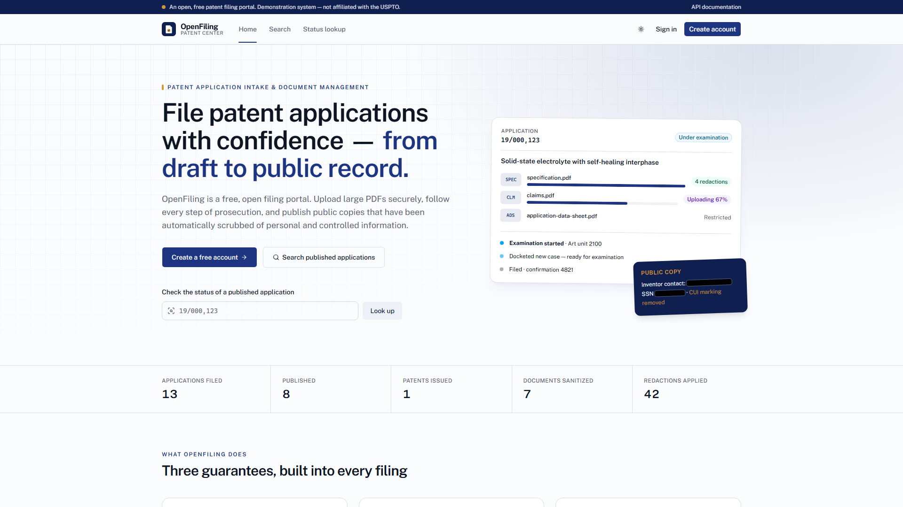

# OpenFiling — secure patent application intake & document management

A free, open, SaaS-style portal (no payments) modelled on USPTO **Patent Center** and **TSDR**: inventors file
patent applications and upload large PDFs straight to object storage, examiners work a prosecution queue, and every
public document is automatically sanitized — PII and CUI redacted by **Claude** plus deterministic rules — into a
"Public Copy". Everything runs locally; every piece is shaped to map 1:1 onto AWS.

[](docs/demo/openfiling-demo.mp4)

▶️ **[Watch the demo on YouTube](https://www.youtube.com/watch?v=PIha3tCbv_w)** — direct-to-S3 upload, AI redaction of PII/CUI,
filing with S-signature, examiner queue & workflow, public TSDR-style status page, admin health & audit log.
(1920×1080 · 30 fps · 8 Mbps · 67 s with voice-over; recorded with [`docs/demo/record-demo.mjs`](docs/demo/record-demo.mjs).)

| Objective | How it is built | Where |
|---|---|---|
| **Secure IP document filing portal** — Angular requests an S3 pre-signed URL and uploads PDFs directly to S3, bypassing the API | `POST /applications/{id}/documents` returns an AWS SDK v2 `S3Presigner` PUT URL (signed `Content-Type`, 15 min); the browser PUTs with `XMLHttpRequest` (progress, cancel); `/complete` verifies size + `%PDF-` magic via HeadObject / ranged GET | `filing-api` (storage, DocumentService), `web` (core/upload), `s3-emulator` |
| **Role-based application status tracker (TSDR)** — strict Spring Security JWT; inventors see only their own applications, examiners a queue of all | RS256 JWT (15 min) + rotating refresh tokens with reuse detection, lockout, Bucket4j auth rate limit; visibility enforced in services (404 for others' data); `WorkflowPolicy` state machine (13 actions, 12 statuses); prosecution history, notifications, audit log in PostgreSQL | `filing-api`, `web` (dashboard, detail, examiner queue, public status) |
| **Automated PII/CUI redaction** — S3 upload of a public document triggers a Lambda that uses Claude to find PII/CUI and saves a sanitized Public Copy to a separate bucket | `ObjectCreated` on `openfiling-documents/public/*.pdf` → Lambda (plain Java 21): PDFBox text + glyph boxes → rules ∪ Claude (`claude-opus-5-5`, structured output) → rasterized image-only PDF with black boxes, metadata stripped → `openfiling-public-copies` + report → status callback | `redaction-lambda`, `s3-emulator` (event notifications) |

```
browser (Angular 22 + ZardUI + Tailwind 4, :4200)
   │ /api (dev proxy)                    │ PUT/GET pre-signed URL (no Authorization header)
   ▼                                     ▼
filing-api :8080 ──SDK v2──────────► s3-emulator :9000  (SigV4-verifying S3; data/buckets/*)
   │ PostgreSQL :5433 (schema filing)    │ ObjectCreated (S3 event JSON)
   │                                     ├──► redaction-lambda :9001 (Lambda Invoke API)
   │◄── /internal/v1/storage/events ─────┘        │ GetObject → detect → PutObject public copy
   │◄── /internal/v1/redactions/events ───────────┘ (status callback)
```

Full API / DB / storage / event contract: [docs/CONTRACTS.md](docs/CONTRACTS.md). Each component has its own README.

## Run it

Prerequisite: the portable toolchain in `D:\JavaSpring\tools` (JDK 21, Node 24, PostgreSQL 18).

```powershell
.\dev.ps1 up          # Postgres + s3-emulator + redaction Lambda runtime + filing-api + Angular, each in its own window
.\scripts\smoke.ps1   # end-to-end: register → upload to S3 → file → redaction → examiner actions → public copy
.\dev.ps1 down
```

- Web: http://localhost:4200 — create a free account, or use the dev accounts (dev profile only):
  `inventor@openfiling.local` / `Inventor#12345`, `examiner@openfiling.local` / `Examiner#12345`, `admin@openfiling.local` / `Admin#12345`.
- API docs: http://localhost:8080/swagger-ui.html · Storage: http://localhost:9000/_emulator/buckets · Lambda: http://localhost:9001/health
- Try it with the fictitious demo PDFs in [`samples/`](samples/README.md) — upload `specification-with-pii.pdf` as a
  PUBLIC Specification and watch the redaction chip turn into "21 redactions".

**Claude detection:** create a git-ignored `.env` next to `dev.ps1` with `ANTHROPIC_API_KEY=...` (optional
`CLAUDE_MODEL`, default `claude-opus-5-5`; `CLAUDE_EFFORT`, default `medium`). Without a key the Lambda runs the
rules-only engine (SSN, tax IDs, phones, e-mails, addresses, DOBs, card/bank numbers, IDs, IPs, CUI banners,
ITAR/EAR/FOUO/distribution markings). With a key it adds context-aware findings (names of private individuals,
medical details, …) while leaving public-record names (inventors, assignees, examiners, cited authors) alone.
Refusals or API errors degrade that chunk to rules-only — a document is never published unchecked.

With Docker Desktop instead: `docker compose up --build` (same ports).

## Build & test

```powershell
.\dev.ps1 build       # every component: compile + tests + JaCoCo gates; web: build + tests
```

| Component | Tests | Coverage gate |
|---|---|---|
| filing-api | 1,985 (workflow policy matrix, auth/refresh reuse, upload verification, visibility, MVC slices, Postgres integration flows) | service ≥ 80% (actual 99.7%) |
| s3-emulator | 53 (AWS SigV4 test vectors, real AWS SDK v2 client + presigner, CORS, event delivery) | ≥ 80% (93.6%) |
| redaction-lambda | 85 (every rule category, glyph mapping, redacted output has no recoverable text/metadata, handler + callbacks, Claude seam) | ≥ 80% (94.7%) |
| web | 91 (auth store, single-flight refresh, guards, direct upload via mocked XHR, API services, formatting) | — |

DB-backed tests use the `openfiling_test` database on localhost:5433 (CI uses a Postgres service container).

## Security notes (Public Trust posture)

- The API never handles file bytes; pre-signed URLs are short-lived, scoped to one key and one content type.
- Unpublished applications are confidential: only the owner, examiners and admins can see them; everyone else gets 404.
- RESTRICTED documents (ADS, oath/declaration) are never redacted or published; PUBLIC documents are only ever
  served to the public as the sanitized copy — rasterized, so no hidden text layer or metadata survives.
- Redaction reports record categories, pages and sources — never the redacted values. Logs never contain document text.
- Every sensitive action (logins, downloads, workflow actions, admin changes) lands in an append-only audit log with
  request id, IP and user agent.

## AWS mapping (reference only — nothing is deployed)

| Local | AWS | Notes |
|---|---|---|
| filing-api | ECS Fargate behind an ALB | task role grants exactly what pre-signed URLs may do |
| PostgreSQL 18 | RDS for PostgreSQL (Multi-AZ, KMS, managed master password) | |
| s3-emulator buckets | S3 (SSE-KMS, block public access, TLS-only policy, CORS for the web origin) | set `S3_ENDPOINT` blank → real S3 |
| emulator ObjectCreated → :9001 | S3 event notification (prefix `public/`, suffix `.pdf`) → Lambda | `.\gradlew.bat lambdaZip` |
| redaction Lambda | Lambda Java 21, SnapStart, reserved concurrency; Anthropic key in Secrets Manager | |
| web `dist/` | S3 + CloudFront | |

See [`infra/terraform`](infra/terraform/main.tf) (not applied).

## Layout

```
filing-api/         Spring Boot 4 · JWT/refresh · workflow · pre-signed URLs · audit · Flyway (schema filing)
s3-emulator/        Spring Boot 4 · SigV4-verifying local S3 · CORS · S3 event notifications
redaction-lambda/   plain Java 21 · Lambda handler + local runtime · PDFBox · rules + Claude · samples generator
web/                Angular 22 · ZardUI · Tailwind 4 · Vitest
samples/            fictitious demo PDFs
docs/CONTRACTS.md   API / DB / storage / event contract
infra/terraform/    AWS reference infrastructure
scripts/smoke.ps1   end-to-end smoke test
dev.ps1             local runner
```
